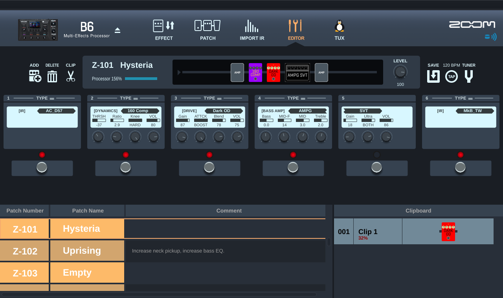
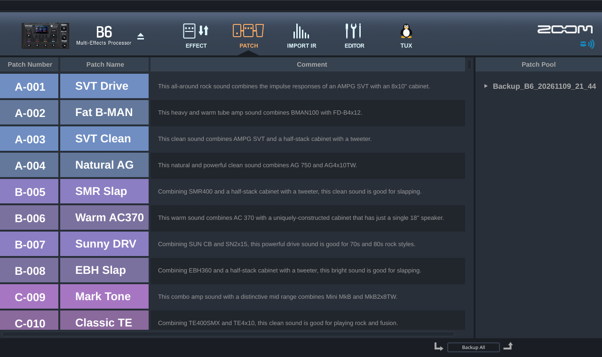
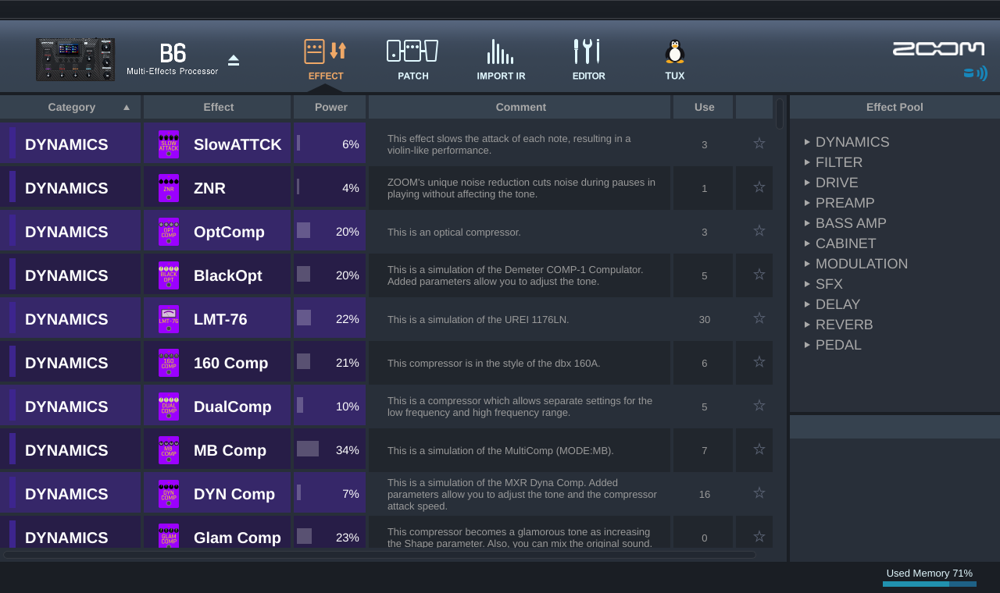
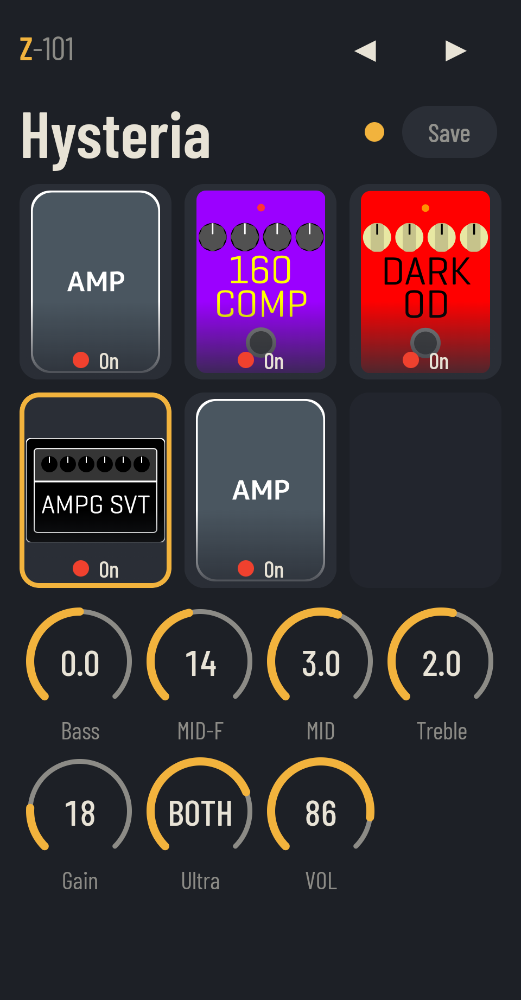
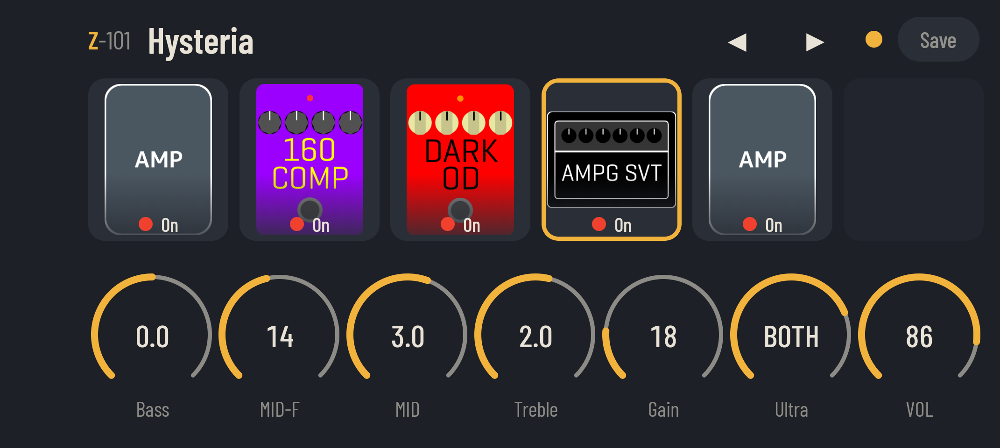
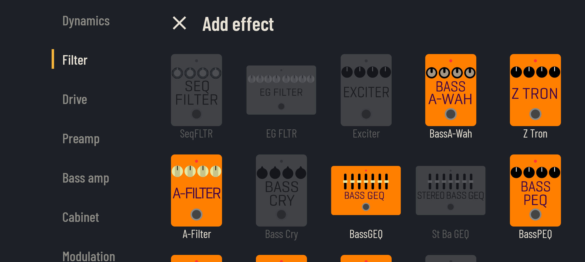

# B6 Lab, B6 Remote and the B6 MCP server

** Yes, this was vibe coded. It was tested extensively on my Zoom B6. Do whatever you want with it, if you dare. ** 

Three free tools for the Zoom B6 bass multi-effects pedal, made because Zoom's own editor
(Guitar Lab) does not run on Linux and its phone app (Handy Guitar Lab) is iOS only:

| App | Runs on | What it is for | How to get it |
|---|---|---|---|
| **B6 Lab** | Linux desktop | Full editor: all 240 patches, effects, knobs, names, patch search, import/export, backups | Run from this repository (see below) |
| **B6 Remote** | Android phone | Live editing of the active patch from a phone on a mic stand, for practice and on stage | Download the APK from the [Releases page](https://github.com/SchitzelKraft/zoom-b6-lab/releases) |
| **B6 MCP server** | Linux, with an AI assistant (Claude Code, Codex or any MCP client) | Ask an assistant to look up, draw, build, audition, tune, rename and search patches, with safety rules built in | Run from this repository (see [B6 MCP server](#b6-mcp-server-ai-assistant-tools)) |

All three talk to the pedal over a USB cable; no Zoom drivers are needed. They share the same
pedal protocol work and the same data files (see [Data files](#data-files-not-in-this-repository)).

## B6 Lab: Linux desktop editor

B6 Lab talks to the pedal over USB MIDI (raw ALSA, no extra drivers) and lets you browse all
240 patch slots, switch the pedal to a slot, edit effect on/off and knobs, rename patches,
import and export `.zptc` files, and save back to the pedal with an automatic backup.
The search field above the patch list (Ctrl+F) finds a patch by number (Z-104 or 104), name
or effect name; Enter or a click switches the pedal to it.

<p>
  
</p>
<p>
  
  
</p>

### Install

    python3 -m venv .venv && .venv/bin/pip install PySide6 pytest pytest-qt "mcp>=2.3,<3"

### Run

    .venv/bin/python -m b6lab           # with the pedal connected and switched on
    .venv/bin/python -m b6lab --fake    # no pedal: uses an in-memory fake device

Only one program can hold the pedal's MIDI port at a time; close other editors and CLI tools first.

## B6 Remote: Android app (APK)

B6 Remote is a separate Android app (an APK you install on the phone). It edits the active patch of a Zoom B6 live over a USB cable (OTG), for practice and on stage. It shows a pedal board with the effect pictures, on/off footswitches and knobs; you can add, change, remove and move effects and save the patch. It follows patch changes you make on the pedal, and works in portrait and landscape. The search button next to the patch arrows finds a patch by number (Z-104 or 104), name or effect name; tap a result and the pedal switches to it.

<p>
  
  
</p>
<p>
  
</p>

### Download and install

Download `B6Remote-1.2.apk` from the [Releases page](https://github.com/SchitzelKraft/zoom-b6-lab/releases). On your phone, allow installing apps from this source when Android asks, then open the APK and install it.

### Requirements

- Android 10 or newer with USB OTG support (a USB-C to Micro-B cable, or a Micro-B cable with an adapter).
- Zoom B6 with firmware 1.00.
- No Bluetooth: the BTA-1 adapter is not supported.

### First use

Switch AUTO SAVE off on the B6 if you want your changes to stay temporary until you tap Save. Connect the B6 to the phone with the cable and switch the pedal on; the app connects by itself.

The effect pictures and effect names shown by the app belong to Zoom Corporation. This project is not affiliated with Zoom.

### Build it yourself

1. Get the data files as described in [Data files](#data-files-not-in-this-repository) below.
2. Run `android/prepare.sh` to copy them into the app.
3. Install JDK 21 and the Android SDK, then run `cd android && ./gradlew :app:assembleDebug`.

## Data files (not in this repository)

B6 Lab uses files that belong to Zoom, so they are not in this repository. You get them from
your own pedal and from Zoom's Guitar Lab 7.3 downloads. All paths below are relative to the
repository folder. Step 2 is required: B6 Lab draws its whole interface with those images and
does not start properly without them. Without the others, names, icons and pictures are missing.

1. **Effect files from your pedal** (effect and knob names, effect icons in the pedal view).
   Connect the B6, switch it on, close every other MIDI program, then:

       python3 tools/ffs_read.py --all              # FLST_SEQ.ZT2 + every .ZD2 into pedal-files/
       .venv/bin/python tools/build_effects.py      # pedal-files/effects.json (also asks the pedal for the IR names)
       python3 tools/extract_zd2_icons.py pedal-files analysis/pedal-reference-assets

   `ffs_read.py` only reads; it takes a few minutes. If it is stopped halfway and the pedal
   stops answering, switch the pedal off and on.

2. **Interface images from Guitar Lab for Mac.** Download "Guitar Lab 7.3 for macOS"
   (`GuitarLab_Mac_v7.3.0.130_E.zip`) from the B6 support page
   (https://zoomcorp.com/en/us/multi-effects/bass-effects/b6/b6-support/) and unzip it. You need no Mac: open the disk image read-only on Linux (`sudo apt install
   dmg2img`) and extract the images from the app's program file:

       dmg2img -s "Guitar Lab Installer.dmg" gl.img
       udisksctl loop-setup -r -f gl.img            # prints /dev/loopN
       udisksctl mount -b /dev/loopN -o ro          # prints the mount folder
       python3 tools/extract_mac_assets.py "<mount folder>/ZOOM Guitar Lab.app/Contents/MacOS/ZOOM Guitar Lab" \
           analysis/mac-reference-assets --ir-svg analysis/win-download/SVG/_IR.svg
       udisksctl unmount -b /dev/loopN && udisksctl loop-delete -b /dev/loopN

   This must give 144 images; B6 Lab finds them by their position in the program file, so
   only Guitar Lab 7.3.0.130 fits.

3. **The B6 picture and the colour effect drawings**, which Guitar Lab downloads from Zoom
   when it runs. The picture can be fetched directly:

       mkdir -p analysis/win-download
       curl -L -o analysis/win-download/model_image3-B6.png \
           https://www.zoom.co.jp/archive/GUITAR_LAB/model_image3/B6.png

   The effect drawings (`<module>.svg`, about 390 files) can only be taken from a Guitar Lab
   that has been connected to the B6 once. Guitar Lab for Windows runs under Wine; after
   it has shown the pedal, copy the folder from its Wine prefix (`~/.wine` unless you chose
   another one with `WINEPREFIX`):

       mkdir -p analysis/win-download/SVG
       cp ~/.wine/drive_c/users/$USER/AppData/Roaming/GL/SVG/*.svg analysis/win-download/SVG/

   (On Windows the folder is `%APPDATA%\GL\SVG`.) Without them the chain shows no effect
   icons.

4. **Knob limits** (`pedal-files/parameter-ranges.json`) are optional. They were built from a
   recording of Guitar Lab talking to the pedal, which is not available outside this project,
   so without the file knob values are shown raw. The same file also tells B6 Lab which `.ZD2`
   belongs to which effect, so the processor load, the BassGEQ sliders and the Clipboard's
   compatibility check also need it.

`--fake` mode also needs a backup set of your patches in `backup/` (PATCH page > Backup All,
while connected to the pedal).

## B6 MCP server: AI assistant tools

`b6lab/mcp_server.py` is a local [MCP](https://modelcontextprotocol.io) server: it gives an AI
assistant a set of tools for the B6, with the safety rules built into the server itself (they
hold whatever the assistant or its approval settings do). The assistant can then do things
like:

- "What is on my pedal? Draw slot 163." (patch list, a text drawing of the effect chain)
- "Make a patch for the bass sound of *For the Love of Money* and let me hear it."
  (build from a spec, audition from a spare Empty slot)
- "Slower phaser, more echo... keep that as slot 165." (live knobs and effects, then save)
- "Rename slot 15 to GZR Wah and put the song in the description." (name and description only)
- "Which patches use an Ampeg SVT?" (search the pedal, backups and downloaded patches)

Slots are numbered 1-240, as on the pedal; knob values are in display units, as the pedal
shows them.

### Set up (once)

1. Install as for B6 Lab (the `mcp` package is in the install line):
   `python3 -m venv .venv && .venv/bin/pip install PySide6 pytest pytest-qt "mcp>=2.3,<3"`
2. Put the data files in place (see [Data files](#data-files-not-in-this-repository)); the
   server needs the effect catalog in `pedal-files/`.
3. Connect the pedal and close B6 Lab (only one program can use the pedal's MIDI port). The
   first tool that needs it makes a full backup in `backup/` (about a minute).
4. For live tuning (audition, knobs, chain edits), switch the pedal's AUTO SAVE off
   (SYSTEM > AUTO SAVE); the server refuses those tools while it is on.

The server is started by the assistant as `<repository>/.venv/bin/python -m b6lab.mcp_server`
(stdio). It finds `backup/`, `pedal-files/` and `downloads/` next to its own code, so it works
from any folder as long as Python can find the `b6lab` package (`PYTHONPATH`, see below).

### Use it with Claude Code

`.mcp.json` in this folder registers the server as `zoom-b6`. Start Claude Code in this folder and
approve the project server when asked (or run `claude mcp reset-project-choices` and start
again if you missed the question). The tools then show up as `mcp__zoom-b6__<tool>`. Suggested
permission rules for `.claude/settings.local.json` are at the end of this section.

### Use it with Codex

Add the server to `~/.codex/config.toml` (replace the path with where you cloned this
repository):

```toml
[mcp_servers.zoom-b6]
command = "/home/you/zoom-b6-lab/.venv/bin/python"
args = ["-m", "b6lab.mcp_server"]
env = { PYTHONPATH = "/home/you/zoom-b6-lab" }
tool_timeout_sec = 180
```

`tool_timeout_sec` matters: the first tool that needs the pedal makes a full backup, which takes
about a minute (Codex's default limit is 60 s). Give other clients a similar timeout when they
have one.

Start Codex; the B6 tools are available in every session. Codex asks for approval according to
its own settings; the tool descriptions mark which tools write to the pedal.

### Other MCP clients

Any client that starts a stdio server works with the same three values: the command
`<repository>/.venv/bin/python`, the arguments `-m b6lab.mcp_server`, and the environment
variable `PYTHONPATH=<repository>`. In the common JSON format (Claude Desktop, Cursor and
others):

```json
{
  "mcpServers": {
    "zoom-b6": {
      "command": "/home/you/zoom-b6-lab/.venv/bin/python",
      "args": ["-m", "b6lab.mcp_server"],
      "env": {"PYTHONPATH": "/home/you/zoom-b6-lab"}
    }
  }
}
```

### Tools

| Tool | What it does | Pedal memory |
|---|---|---|
| `list_patches` | All 240 slots from the newest full backup (`refresh` re-reads the pedal) | read |
| `get_patch`, `current_patch` | One patch: effects, knobs, DSP percent, footswitches | read |
| `list_effects`, `effect_info` | Effect catalog, knobs, DSP load, real gear | none |
| `validate_patch`, `build_patch` | Check a spec; build it to `downloads/patches/created/` | none |
| `install_patch` | Write a `.zptc` file or a spec to an Empty slot | write |
| `clear_slot` | Undo one of the server's own installs | write |
| `backup_pedal` | Full backup of all 240 slots to `backup/` | read |
| `pedal_info` | Everything the pedal reports: firmware, settings, effect memory, installed effects | read |
| `pedal_status` | What the pedal plays now, AUTO SAVE, unsaved changes | read |
| `audition_patch` | Play a `.zptc` file or a spec from a scratch Empty slot | scratch slot |
| `set_knob`, `set_effect_on` | Change the patch the pedal plays now, read back | none (not stored) |
| `revert_edit` | Play the stored patch again (ends an audition) | scratch slot |
| `save_edit` | Store what the pedal plays now to an Empty slot | write |
| `add_effect`, `remove_effect`, `move_effect`, `change_effect` | Change the chain of the patch the pedal plays now, read back | none (not stored) |
| `rename_patch` | New name and/or description for any non-empty slot, nothing else | write |
| `draw_patch` | A patch as a text pedalboard (also in `get_patch` and `pedal_status`) | read |
| `search_patches` | Find patches on the pedal, in backups and in `downloads/patches/` by name, description, effect or real gear | none |
| `compare_patches` | Differences between two patches (slot, file or what the pedal plays), with drawings | read |

### Safety rules

- Patches are installed to Empty slots only; any other slot is refused. The pedal switches
  to the slot only when asked (`select`).
- Every write first backs up the slot to `backup/overwritten/`; the first write of each server
  session also makes a full backup of all 240 slots.
- `rename_patch` is the only tool that writes a slot that is not Empty: it changes the name
  and description only (checked byte for byte), needs the slot's current name, and is refused
  while that slot plays with unsaved changes.
- Every write is logged in `backup/writes.jsonl`.
- `clear_slot` only undoes the server's own installs, and only while the slot still holds
  exactly what it wrote; your own patches are never touched.
- `audition_patch`, `set_knob`, `set_effect_on` and the chain edits are refused while the pedal's AUTO SAVE is
  on (it would store the changes): switch it off on the pedal (SYSTEM > AUTO SAVE). The server
  never changes this setting.
- Only one program can hold the pedal's MIDI port: close B6 Lab while the server talks to the
  pedal. The server opens the port per tool call and never takes it from another program.

### Claude Code permissions

Rules for `.claude/settings.local.json` (read, offline and live tools
allowed, writes to pedal memory asked every time):

```json
{
  "permissions": {
    "allow": [
      "mcp__zoom-b6__list_patches",
      "mcp__zoom-b6__get_patch",
      "mcp__zoom-b6__current_patch",
      "mcp__zoom-b6__list_effects",
      "mcp__zoom-b6__effect_info",
      "mcp__zoom-b6__validate_patch",
      "mcp__zoom-b6__build_patch",
      "mcp__zoom-b6__pedal_info",
      "mcp__zoom-b6__pedal_status",
      "mcp__zoom-b6__audition_patch",
      "mcp__zoom-b6__set_knob",
      "mcp__zoom-b6__set_effect_on",
      "mcp__zoom-b6__revert_edit",
      "mcp__zoom-b6__draw_patch",
      "mcp__zoom-b6__add_effect",
      "mcp__zoom-b6__remove_effect",
      "mcp__zoom-b6__move_effect",
      "mcp__zoom-b6__change_effect",
      "mcp__zoom-b6__search_patches",
      "mcp__zoom-b6__compare_patches"
    ],
    "ask": [
      "mcp__zoom-b6__install_patch",
      "mcp__zoom-b6__clear_slot",
      "mcp__zoom-b6__backup_pedal",
      "mcp__zoom-b6__save_edit",
      "mcp__zoom-b6__rename_patch"
    ]
  }
}
```

## Tools

- `python3 tools/ffs_read.py NAME... | --list | --all`: read files from the pedal's internal
  file system into `pedal-files/` (read-only; logs every message to `pedal-files/ffs.log`).
- `.venv/bin/python tools/build_effects.py [--no-pedal]`: build `pedal-files/effects.json`
  (effect and knob names) from the `.ZD2` effect files and the pedal's IR name list.
- `python3 tools/extract_zd2_icons.py MODULES OUTPUT`: the effect bitmaps inside `.ZD2` files.
- `python3 tools/extract_mac_assets.py BINARY OUTPUT [--ir-svg FILE]`: the PNG images inside
  Guitar Lab for Mac's program file.

## Safety rules

- Every save first copies the slot's current content to `backup/overwritten/`.
- After every write the slot is read back and compared; a mismatch is reported as a failure.
- To undo a save: every save keeps the previous slot content in
  `backup/overwritten/<time>_slotNNN_<name>.zptc`; restore it with Patches > Import .zptc into that slot.
- In `--fake` mode nothing is written to the real backup folders: save backups go to
  `backup/fake/overwritten/` and "Back up all" to `backup/fake/`.
- If the pedal stops answering, the light turns grey with the reason; use Reconnect to connect again
  and re-read all patches.
- If the slot changed on the pedal since it was loaded, the app asks before overwriting.
- Take a full backup before experimenting: PATCH page > Backup All.

## Known limits

- Effect and knob names come from `pedal-files/effects.json`, built from your pedal's own
  effect files. Without that file, boxes show the raw effect ID and knobs P1..Pn. IR boxes
  show the IR name, but their knobs stay P1..P4 (the pedal has no names for them).
  To rebuild it, for example after installing new effects with Guitar Lab, repeat step 1
  of "Data files".
- All knobs are editable. Knobs 1-4 were confirmed with a knob test on the pedal; 5 and up
  by checking every stored value of all patches against Zoom's knob ranges. Values stored
  beyond an effect's named knobs are shown small, marked "hidden", and stay read-only.
- Knob limits for the captured effect modules come from the pedal's `64 06` parameter-info
  records. Numeric displays are derived from the documented endpoints when the captured
  limit supports a simple linear scale; enumerated labels come from the effect list. Where
  the display mapping is unknown, the value is marked `raw`. IR controls and effects without
  matching captured metadata still use the existing raw controls. Limits are ignored if an
  effect file changes, until a matching capture is available.
- Effect on/off and knobs are live: the pedal hears a change right away (in its edit
  buffer, the way Guitar Lab does it; see `b6lab/live.py`). A switch shows the state the pedal
  reports; after you stop turning a knob, B6 Lab reads the pedal back and reports any difference
  in the status bar. Nothing is stored until Save; with AUTOSAVE off, switching patch on the pedal
  discards the change. Name, comment and patch level are still heard only after Save.
- No adding, removing or reordering of effects.
- The Effect view lists the extracted B6 effects and counts their uses in the loaded
  patches. Power percentages and favorites are not yet available; the Effect Pool,
  Patch Pool, Clipboard, Import IR, and News do not yet reproduce Guitar Lab's full
  functionality. Effect editing remains available through the Editor view.
- The screenshots supplied for the interface show bank labels and colors through Z;
  later slots use a numeric label and neutral color until their original appearance
  can be verified.

## Protocol notes

See `analysis/PROTOCOL.md` for the SysEx protocol, the PTCF patch format and what has been
verified on hardware.
